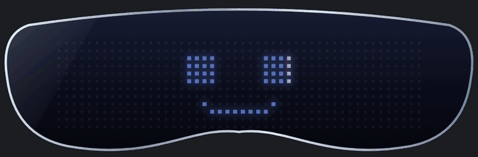
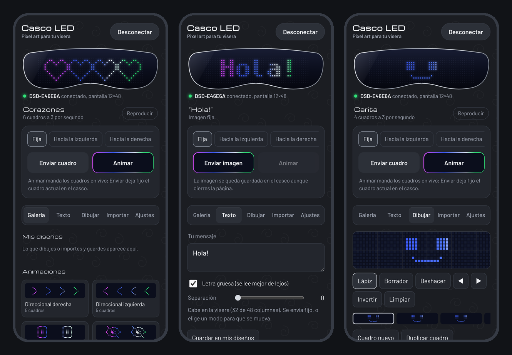
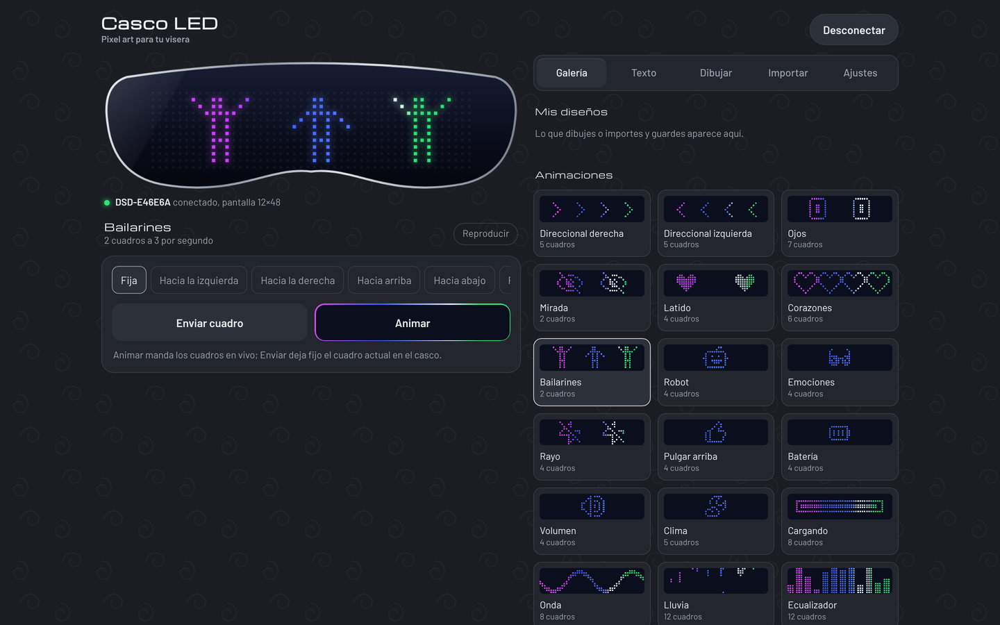

<div align="center">

# Casco LED

**Pixel art, animaciones y texto para la visera LED de tu casco, directo desde el navegador.**



[**Abrir la app →**](https://bryangep.github.io/casco-led/)


</div>

---

Estos cascos con pantalla LED de 12×48 traen una app oficial (*Magic Display*) muy limitada: unas cuantas animaciones fijas y un editor pequeño. Este proyecto descifra el protocolo Bluetooth del casco y lo reemplaza por una app web en un solo archivo, con galería, editor de animaciones, texto libre e importación de GIFs.

## Capturas

<p align="center">
  
</p>

<p align="center">
  
</p>

## Qué puedes hacer

| | |
|---|---|
| **Galería** | 18 animaciones y 2 tiras listas: direccionales, ojos, corazones, bailarines, ecualizador, lluvia y más. Tocas una y la mandas. |
| **Texto** | Escribes con el teclado. Si cabe se queda fijo; si es largo se vuelve una tira que se desplaza. Con acentos, ñ, ¿ y ¡, y opción de letra gruesa. |
| **Dibujar** | Editor de pixel art de 48×12 con cuadros para hacer tus propias animaciones. Se guardan en *Mis diseños*. |
| **Importar** | Carga PNG, JPG, GIF o WEBP. Se convierten a 12 px de alto en blanco y negro, con umbral ajustable. |
| **Modos** | Fijo, desplazar en cuatro direcciones o parpadeo, además de brillo y velocidad. |
| **Animación en vivo** | Las animaciones se mandan cuadro por cuadro, enviando solo las columnas que cambian para que se vean fluidas. |

## Cómo usarla

**En iPhone**
1. Instala [Bluefy](https://apps.apple.com/app/id1492822055) (gratis). Safari no permite Bluetooth en páginas web.
2. Abre **https://bryangep.github.io/casco-led/** dentro de Bluefy.
3. Cierra *Magic Display* (el casco solo acepta una conexión a la vez).
4. Toca **Conectar casco** y elige el dispositivo que empieza con `DSD-`.

**En la computadora**
Abre la página en **Chrome** o **Edge** con el Bluetooth activado y sigue los mismos pasos.

> Las imágenes y tiras enviadas se quedan guardadas en el casco. Las animaciones en vivo corren mientras la página esté abierta y la pantalla encendida.

Para volver a la app oficial, solo desconecta aquí y abre *Magic Display*. No se modifica nada del casco.

## Compatibilidad

Probado con un casco que se anuncia como `DSD-xxxxxx` y responde `STYPE12X48N` (pantalla de 12 filas × 48 columnas, monocromática; los colores los pone el hardware por columna). Otros dispositivos que usan *Magic Display* tienen pantallas de 5×36, 14×56 o 16×64; el protocolo es el mismo, pero esta app está ajustada a 12×48.

## Cómo se hizo

El protocolo no está documentado, así que se obtuvo por ingeniería inversa:

1. **Exploración BLE** con *nRF Connect*: el casco expone el servicio `FEE9` (Quintic QPP) con tres características de escritura y una de notificación.
2. **Descompilación** de la app Android con *jadx*. Cada paquete es de 16 bytes y va cifrado con **AES-128 ECB**; la llave estaba en una librería nativa (`libAES.so`).
3. **Validación**: con esa llave, la respuesta real del casco se descifra como `STYPE12X48N`.
4. **Reimplementación** en Python (`casco.py`) y en JavaScript (`index.html`), comprobando byte por byte contra la lógica de la app original. Dos detalles se ajustaron probando en el casco real: el orden de las filas del modo en vivo y la espera de 1.5 s que necesita al entrar a ese modo.

<details>
<summary><b>Detalles del protocolo</b></summary>

| Característica | Dirección | Uso |
|---|---|---|
| `d44bc439-…-925416129600` | escritura | Comandos |
| `d44bc439-…-92541612960a` | escritura | Datos de imagen, bloques de 15 bytes |
| `d44bc439-…-92541612960b` | escritura | Modo en vivo, una columna por paquete |
| `d44bc439-…-925416129601` | notificación | Respuestas del casco |

Todos los paquetes son `[longitud, ASCII..., argumentos]`, rellenados a 16 bytes y cifrados.

| Comando | Para qué |
|---|---|
| `STYPE` | Pregunta el tipo de pantalla |
| `DATS hi lo 0 0` | Anuncia una transferencia; el casco responde `DATSOK` |
| `DATCP` | Cierra la transferencia; responde `DATCPOK` |
| `MODE n` | 1 fijo, 2 parpadeo, 3 izquierda, 4 derecha, 5 arriba, 6 abajo |
| `LIGHT n` / `SPEED n` | Brillo y velocidad (0–100) |
| `SMVEW 1/0` | Entra o sale del modo en vivo |

**Imagen:** cada par de columnas de 12 px se empaqueta en 3 bytes. **Modo en vivo:** `[3, columna, alto, bajo]`, donde la palabra de 16 bits tiene la fila 0 en el bit 15.

</details>

## Línea de comandos (opcional)

`casco.py` hace lo mismo desde la terminal, útil para pruebas o para automatizar.

```bash
pip install bleak pycryptodome pillow

python casco.py info                                   # tipo de pantalla
python casco.py imagen dibujo.png                      # imagen fija
python casco.py tira tira.png --modo izq               # tira que se desplaza
python casco.py gif animacion.gif --vivo --pausa 0 --fps 4
python casco.py brillo 80
```

## Archivos

```
index.html   la app completa (HTML, CSS, JS, galería y fuente en un solo archivo)
casco.py     herramienta de línea de comandos en Python
docs/        imágenes de este README
```

## Créditos

- Iconos de la galería basados en [**pixelarticons**](https://github.com/halfmage/pixelarticons) de Gerrit Halfmann (licencia MIT).
- Fuente de texto [**Spleen**](https://github.com/fcambus/spleen) 6×12 de Frederic Cambus (licencia BSD de 2 cláusulas).
- Tipografías de la interfaz: [Michroma](https://fonts.google.com/specimen/Michroma) y [Barlow](https://fonts.google.com/specimen/Barlow) (SIL Open Font License).

Proyecto independiente, sin relación con los fabricantes del casco ni de la app *Magic Display*.

## Autor

**Bryan Gael Esquivel Pérez** · [GitHub](https://github.com/BryanGEP) · [LinkedIn](https://www.linkedin.com/in/bryan-esquivel-perez)

Licencia [MIT](LICENSE).
